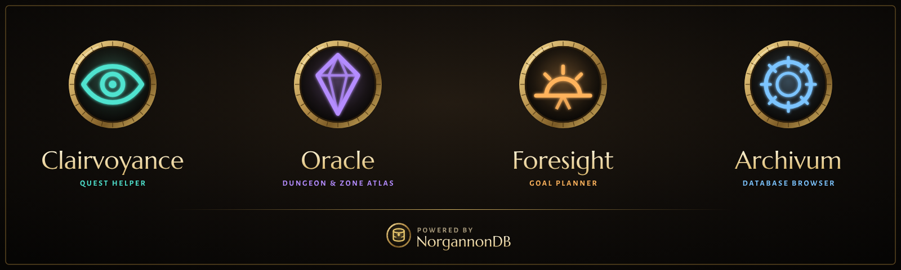

  

  
  
  

> [!WARNING]
> **Very much a work in progress.** This is an early build for WoW Forever (client 1.60.1), in
> active development and testing. Expect missing features, rough edges, bugs, and changes that
> break things between versions. Bug reports and feedback are welcome in
> [Issues](../../issues).

# NorgannonDB Core

**The engine under the NorgannonDB suite.** Core is what makes Clairvoyance and Oracle feel like
one family: the same look, the same map markers, the same colours for your quests, one settings
page, and the work done once instead of once per add-on.

You don't need to do anything with it: install it alongside the suite's add-ons and they take care
of the rest.

## The NorgannonDB suite

|   | Add-on | |
|:-:|---|---|
|  | **[Clairvoyance](https://github.com/zmarotrix/Clairvoyance)** | Quest helper: your objectives on the map, minimap and compass, and a modern tracker |
|  | **[Oracle](https://github.com/zmarotrix/Oracle)** | Dungeon and zone atlas: maps, bosses, loot, zones and professions |
|  | **[NorgannonDB](https://github.com/zmarotrix/NorgannonDB)** | The open game database underneath, with **NorgannonDB Core**, the shared runtime |
|  | **[NorgannonDB Collector](https://github.com/zmarotrix/NorgannonDBCollector)** | Help map Azeroth: improves the database while you play |
|  | Foresight | Planner. *Coming later* |
|  | Archivum | Look anything up in game. *Coming later* |

## Getting started

Download it (**Code → Download ZIP**), extract it into your WoW Forever `Interface/AddOns` folder,
and rename the folder from `NorgannonDB_Core-main` to `NorgannonDB_Core`. It needs
**[NorgannonDB](https://github.com/zmarotrix/NorgannonDB)** too.

| Command | What it does |
|---|---|
| `/norg` | the suite's settings, status and credits |
| `/norg perf` | measure the suite's performance against its budgets |
| `/norg ui` | the UI kit gallery |
| `/norg demo` | preview the map, compass and arrow with your quest log |
| `/norg compass on\|off\|move\|lock` | turn the objective compass on or off, or move it |
| `/norg debug` | debug output |

---

## Technical details

<b>What Core provides</b>

- the client layer, events and messages
- player state: quest log, completed quests, professions, reputation, position
- name search and relation lookups over NorgannonDB, including recipes
- the suite's UI kit: windows, lists, tabs, chips, bars, search boxes and more
- the shared map layer for the world map and minimap, the objective compass and the waypoint arrow
- shared quest colours
- minimap buttons, and the suite's Settings page

Its API is versioned (`Core:Require(major, minor)`, currently 1.14).

<b>Licence</b>

NorgannonDB Core is free to download and use. The source is published for transparency, but all
rights are reserved for now; see [LICENSE](LICENSE) and
[THIRD-PARTY-NOTICES.md](THIRD-PARTY-NOTICES.md). Made by **Maro**.

